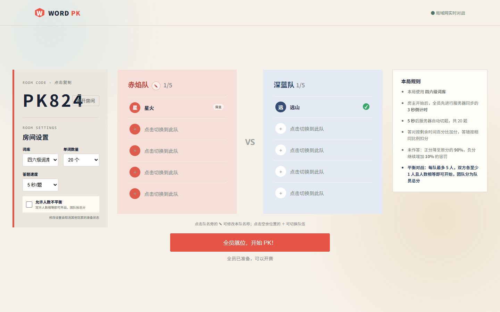

# Word PK

基于 Vue 3、Node.js 和 Socket.IO 的多人实时词汇对战网页。玩家通过房间码加入同一场比赛，支持平衡组队、不平衡组队和个人马拉松赛制。



## 功能

- 最多 5v5 组队对战，平衡模式要求双方人数相等。
- 不平衡模式允许双方人数不同，团队成绩按队内平均分计算。
- 最多 10 人参加的马拉松赛，率先超过 4219 分获胜。
- 房主可设置词库、题目数量、每题时间和是否允许人数不平衡。
- 提供四六级、考研、中考和高考四套词库。
- 房间码邀请、队伍切换、队名修改、准备状态及原房间再来一局。
- 服务器统一控制题目、倒计时、计分和结算。
- 使用低延迟样本过滤的双向时间校准，并在切题时重新同步。
- 逐题个人结算、队伍结算及离线玩家成绩保留。
- 记录房间创建、开赛、结赛和销毁日志。
- 支持桌面端和移动端响应式布局。

## 比赛规则

- 答对：按提交时的剩余时间百分比加分。
- 答错：按相同的剩余时间百分比扣分。
- 未作答：正分变为原分的 90%；负分额外增加 10% 惩罚。
- 所有赛制开赛前均有服务器同步的 3 秒倒计时。
- 马拉松连续 10 题无人作答时，服务器自动销毁房间。

## 技术栈

- Vue 3 + Vite
- Node.js + Express
- Socket.IO（仅使用 WebSocket 传输）

## 运行要求

- Node.js 20 或更高版本
- pnpm（推荐）或 npm
- TCP 端口 `3000` 和 `3001` 可访问

## 安装与运行

```powershell
pnpm install
pnpm run build
pnpm start
```

然后访问：

```text
http://服务器地址:3000
```

- `3000`：网页和运行时配置接口。
- `3001`：独立的 Socket.IO WebSocket 游戏服务。

服务默认监听所有网络接口。在局域网或公网部署时，需要在防火墙和安全组中放行上述两个 TCP 端口。

## 开发

分别启动前端开发服务器和游戏服务器：

```powershell
pnpm run dev
pnpm run server
```

生产构建：

```powershell
pnpm run build
```

联机冒烟测试：

```powershell
node scripts/smoke.mjs
```

测试会临时使用 `3099` 和 `3100` 端口。

## 环境变量

| 变量 | 默认值 | 说明 |
| --- | ---: | --- |
| `PORT` | `3000` | 网页服务端口 |
| `SOCKET_PORT` | `3001` | WebSocket 游戏服务端口 |
| `START_COUNTDOWN_MS` | `3000` | 开赛倒计时毫秒数 |
| `LOG_FILE` | `logs/wordpk.log` | JSONL 日志文件路径 |

## 词库

词库随仓库一起提供，不应加入 `.gitignore`：

| 文件 | 内容 |
| --- | --- |
| `cet46.data` | 四六级词库 |
| `ky.data` | 考研词库 |
| `cz.data` | 中考词库 |
| `gz.data` | 高考词库 |

每行数据为一个 JSON 对象，服务器启动时会加载并整理释义、词性和音标。

## 鸣谢

本项目使用的英语词库整理自 [kajweb/dict](https://github.com/kajweb/dict)。感谢原项目作者收集并公开四级、六级、考研及其他英语词典数据，为本项目的题库功能提供了数据基础。

## 日志

服务器会将日志实时格式化输出到控制台，同时以一行一条 JSON 的形式追加到 `logs/wordpk.log`。日志目录属于运行数据，不纳入 Git。

主要事件包括：

- `room_created`
- `match_started`
- `match_finished`
- `room_destroyed`

## 项目结构

```text
wordPK/
├─ src/                 Vue 前端
├─ server/              Express 与 Socket.IO 服务端
├─ scripts/             冒烟测试和介绍文档生成脚本
├─ docs/                网站介绍及页面截图
├─ *.data               四套词库
├─ index.html
├─ package.json
└─ vite.config.js
```

更完整的页面介绍见 [`docs/WordPK网站介绍.html`](docs/WordPK网站介绍.html)。
